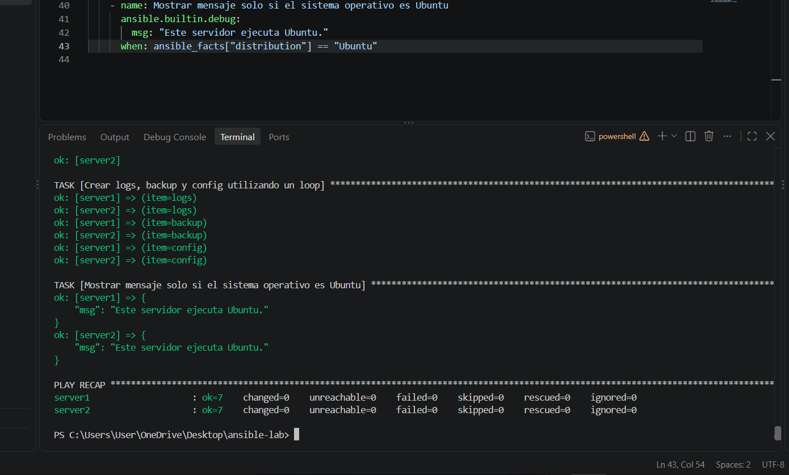

# Laboratorio de Ansible con Docker


## 1. Iniciar los contenedores

Abrir una terminal de VS Code en la carpeta `ansible-lab` y ejecutar:

```powershell
docker compose up -d --build
docker ps
```

Deberían mostrarse `server1`, `server2` y `ansible-lab-controlador-1` (el nombre del servicio auxiliar puede llevar prefijos).

## 2. Instalar Python 3 en los dos servidores

Los contenedores Ubuntu mínimos no incluyen necesariamente Python; Ansible lo necesita para recopilar datos y ejecutar módulos.

```powershell
docker exec server1 bash -c "apt-get update && apt-get install -y python3"
docker exec server2 bash -c "apt-get update && apt-get install -y python3"
```

> Esta instalación se hace dentro de los contenedores. Si se eliminan y recrean desde cero, habrá que repetirla.

## 3. Verificar la conexión de Ansible

```powershell
docker compose exec controlador ansible docker -i inventory.ini -m ping
```

Los dos servidores deben responder `SUCCESS` con `"ping": "pong"`.

## 4. Ejecutar el playbook

```powershell
docker compose exec controlador ansible-playbook -i inventory.ini playbook.yml
```

El resumen final `PLAY RECAP` debe indicar `failed=0` y `unreachable=0` para `server1` y `server2`.

## 5. Verificar los resultados

```powershell
docker exec server1 cat /tmp/ansible-demo/info.txt
docker exec server2 cat /tmp/ansible-demo/info.txt
docker exec server1 ls -l /tmp/ansible-demo
docker exec server2 ls -l /tmp/ansible-demo
```

Cada servidor debe contener su propio `info.txt` y los tres directorios `logs`, `backup` y `config`.

## Evidencia de ejecución exitosa

La siguiente captura muestra la ejecución exitosa del playbook de Ansible en ambos servidores Ubuntu, sin errores.



## Apagar el laboratorio

Cuando hayas terminado:

```powershell
docker compose down
```

Este comando detiene y elimina los contenedores de este laboratorio. No elimina las imágenes ni los contenedores de otras prácticas.
